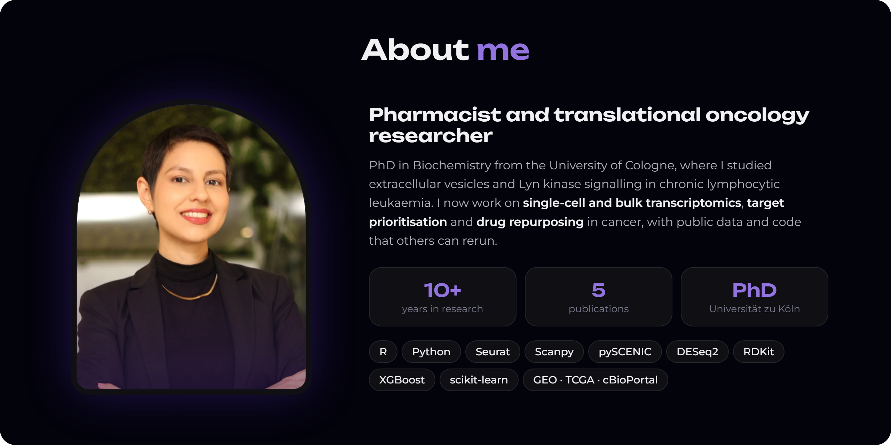
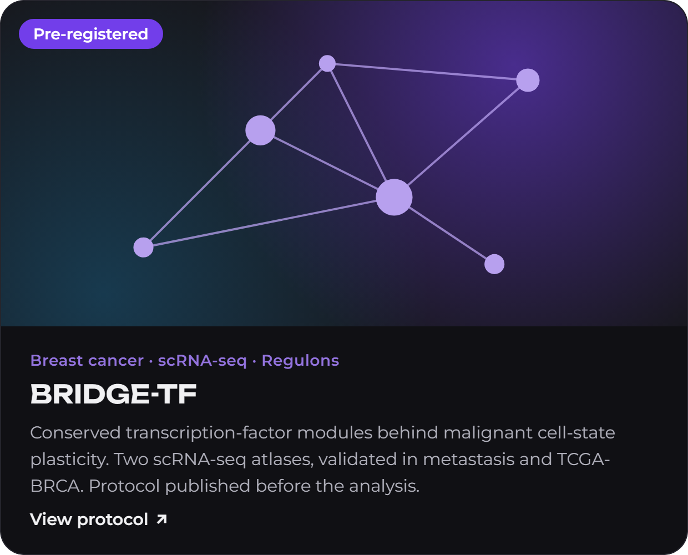
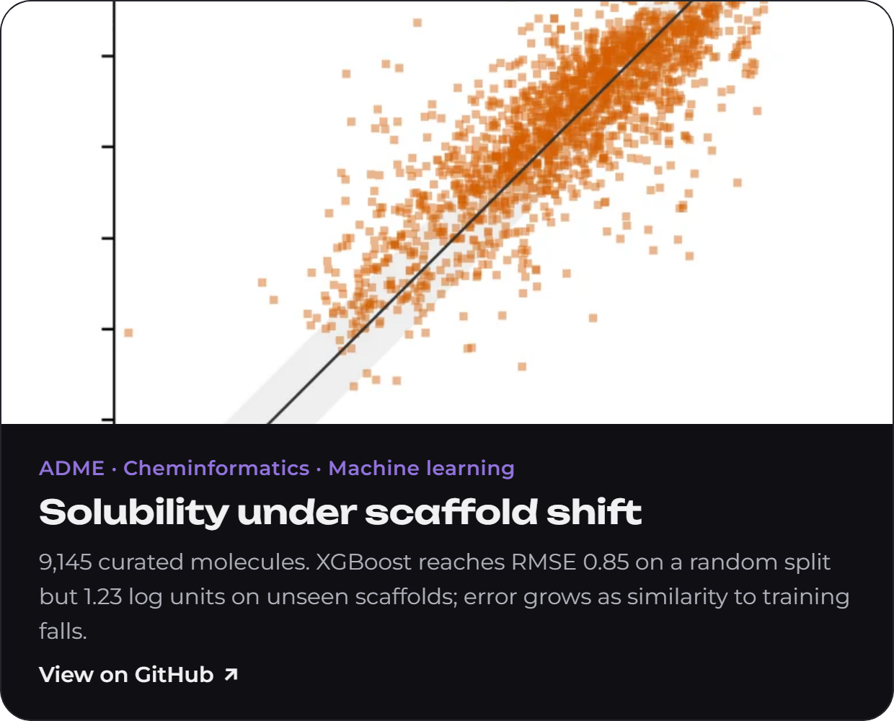
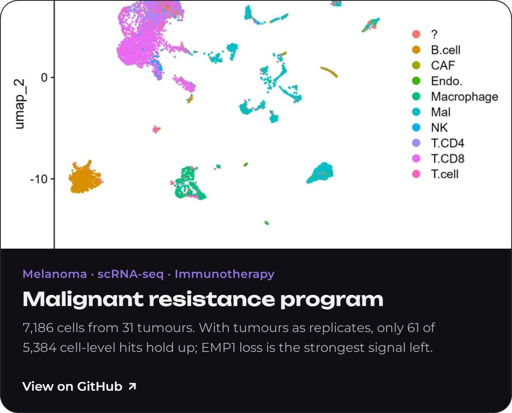
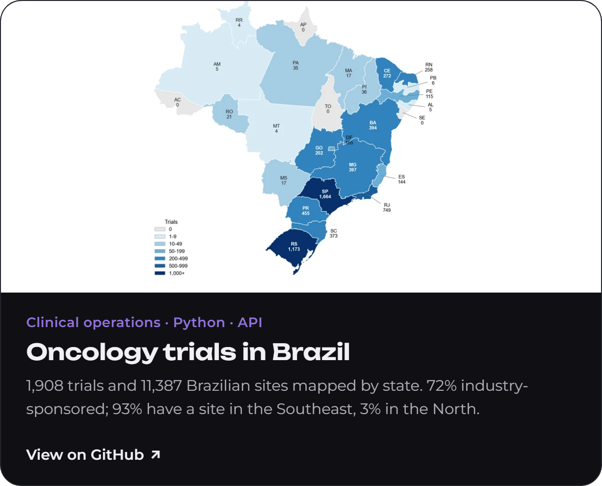
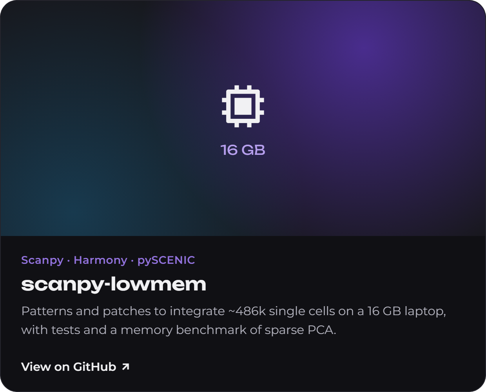
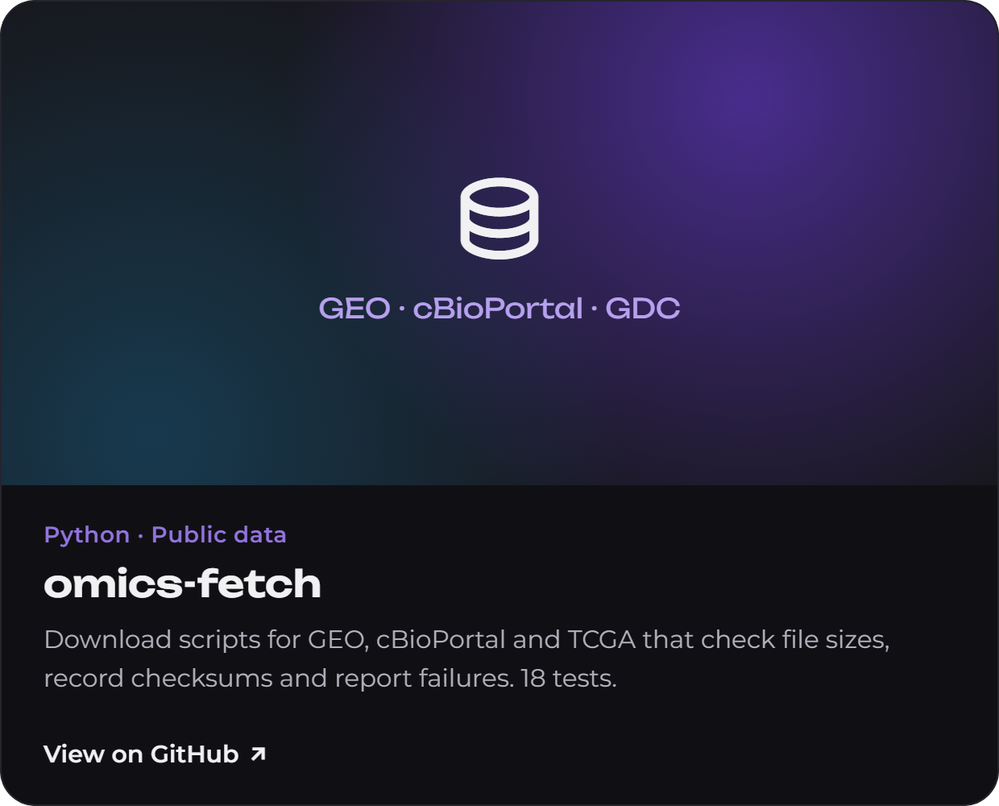
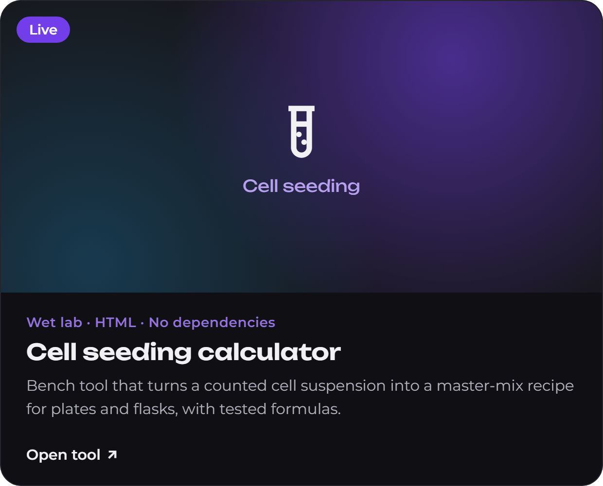
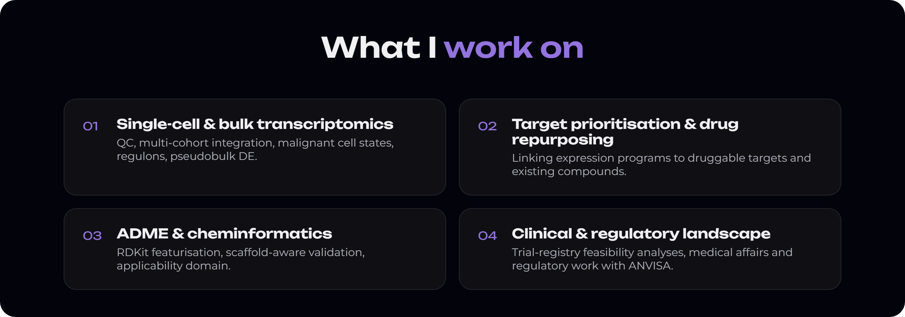

  
  

  
  

  
  

  

- **2026** · Proteomic and functional comparison of extracellular vesicles from wild-type and Lyn-deficient stromal cells. *Advances in Experimental Medicine and Biology*, Springer Nature (book chapter). [doi](https://doi.org/10.1007/978-3-032-21638-0_5)
- **2023** · Stromal cells support the survival of human primary CLL cells through Lyn-driven extracellular vesicles. *Frontiers in Medicine*. [doi](https://doi.org/10.3389/fmed.2022.1059028)
- **2021** · CD30-positive extracellular vesicles enable the targeting of CD30-negative DLBCL cells by brentuximab vedotin. *Frontiers in Cell and Developmental Biology*. [doi](https://doi.org/10.3389/fcell.2021.698503)
- **2021** · Intracellular targeting of PLGA nanoparticles by surface functionalization with peptides. *Journal of Biomedical Nanotechnology*. [doi](https://doi.org/10.1166/jbn.2021.3108)
- **2017** · Inhibition of melanoma metastasis by dual-peptide PLGA NPs. *Biopolymers*. [doi](https://doi.org/10.1002/bip.23029)

  
  
  

